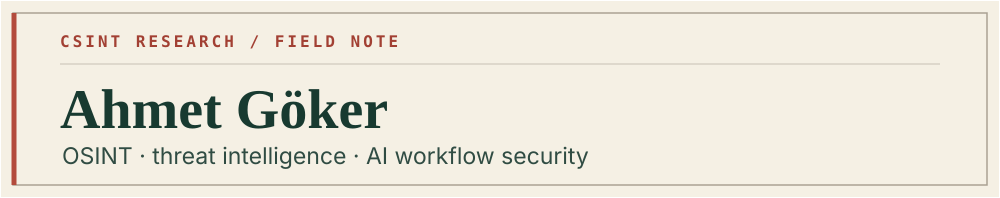

<picture>
  <source media="(prefers-color-scheme: dark)" srcset="./assets/profile-note-dark.svg">
  
</picture>

Hi, I'm **Ahmet Göker**. I run [CSINT Research](https://en.csintresearch.org/) on my own.

Most of what I do is digging into real events, files and odd software behaviour with public records, then writing it up so you can check every step yourself. On the side I build small defensive tools and practice labs, mainly for OSINT and for reviewing AI automation workflows.

[CSINT Research (English)](https://en.csintresearch.org/) · [CSINT Research (Türkçe)](https://csintresearch.org/) · [LinkedIn](https://www.linkedin.com/in/ahmet-g%C3%B6ker) · [X](https://x.com/_shadowintel_)

## What I'm working on

### [n8n AI Agent Security Lab](https://github.com/0xCD4/n8n-ai-agent-security-lab)

An n8n AI workflow can turn risky between two releases without anyone noticing. The scanner reads an exported workflow on your machine, never runs it, and shows where outside input reaches a model or where a model can write somewhere without anyone approving it.

There's a pull-request check for GitHub, a [sample review](https://github.com/0xCD4/n8n-ai-agent-security-lab/blob/main/reports/sample-security-review.pdf), and a [scan of the 100 most-viewed public AI Agent templates](https://github.com/0xCD4/n8n-ai-agent-security-lab/blob/main/research/template-study/top-100/summary.md). The scan report also says what it can't tell you.

### [GOSI-ready OSINT VM](https://github.com/0xCD4/gosi-ready-osint-vm)

A shared VM image can quietly carry someone's cookies, keys and shell history. So this one is a setup script you can read before running it on a clean Ubuntu 24.04 machine. It also sets up case folders and templates for the boring but important parts: evidence log, source reliability, timeline, final report.

Grab the [latest release](https://github.com/0xCD4/gosi-ready-osint-vm/releases/latest), or read the [project page](https://en.csintresearch.org/gosi-ready-osint-vm) first. I made it while studying GIAC GOSI material. It isn't a certification and it isn't affiliated with GIAC.

### [TraceFlow](https://github.com/0xCD4/traceflow-thesis)

My undergraduate thesis at Erciyes University, finished in October 2025. I looked at what a small DynamoRIO client really records while a Linux binary runs, wrote down where my prototype fell short, and sketched a thread-aware version. The [full PDF](https://github.com/0xCD4/traceflow-thesis/blob/main/TraceFlow_Thesis.pdf) is in the repo.

## Two recent write-ups

- **Same JPEG, different pixels** ([English](https://en.csintresearch.org/articles/same-jpeg-different-pixels), [Türkçe](https://csintresearch.org/haber/jpeg-kenar-pikselleri)) 
  If you decode only part of a JPEG, the edge columns don't match a crop of the full image. I counted how many pixels change and found the reason in libjpeg-turbo's machine code.
- **Which uppercase I does Windows use?** ([English](https://en.csintresearch.org/articles/windows-turkish-i-ntfs), [Türkçe](https://csintresearch.org/haber/windows-turkce-i-ntfs)) 
  `izmir.txt` and `İZMİR.txt` can live in the same NTFS folder as two separate files, even though Turkish rules say they're the same name. The volume's own `$UpCase` table predicted the result for all six pairs I tested.

Everything else is in the [research archive](https://en.csintresearch.org/e-library) ([Türkçe](https://csintresearch.org/e-kutuphane)).

## More labs

- **[N4TIVE](https://github.com/0xCD4/N4TIVE)**: six Android challenges hidden in native `.so` libraries, from a simple overflow up to a tiny custom VM.
- **[Linux Kernel Exploitation CTF Lab](https://github.com/0xCD4/kernel-ctf-lab)**: five buggy kernel modules in QEMU, with mitigations turned on one at a time.
- **[Operation Glass Harbor](https://github.com/0xCD4/operation-glass-harbor)**: a made-up incident to investigate. All the people, domains and logs in it are fake.
- **[OWASP LLM Security Lab](https://github.com/0xCD4/OWASPLLMsecurity)** (in Turkish): one lab per item of the OWASP Top 10 for LLM Applications 2025. It runs locally with a built-in simulator, so you don't need an API key.
- **[RAGPoison Lab](https://github.com/0xCD4/RAGPoison-Lab)** (in Turkish): try to slip a poisoned document into a chatbot's knowledge base. [Play it in the browser](https://0xcd4.github.io/RAGPoison-Lab/).
- **[WhenFree](https://github.com/0xCD4/WhenFree)**: nothing to do with security. A little Windows tool that finishes a delete, move or rename once the file is no longer locked.

Older reverse-engineering experiments are still in the repositories tab.
